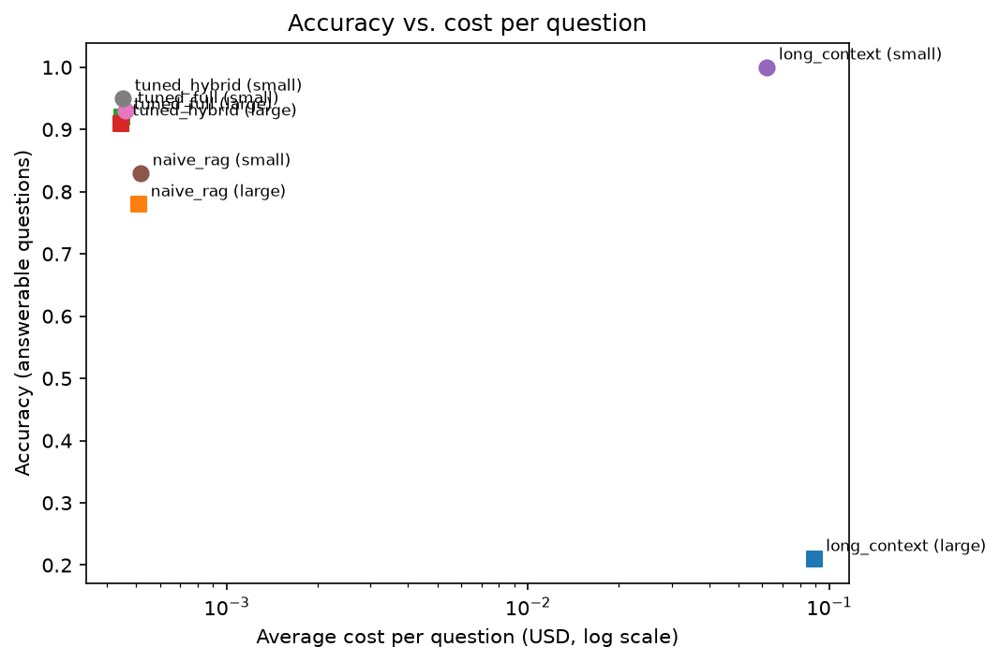
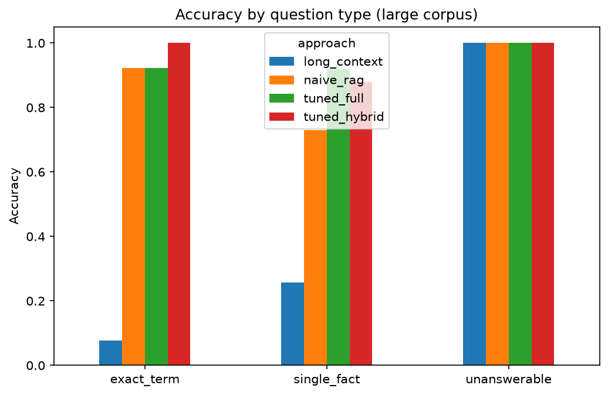
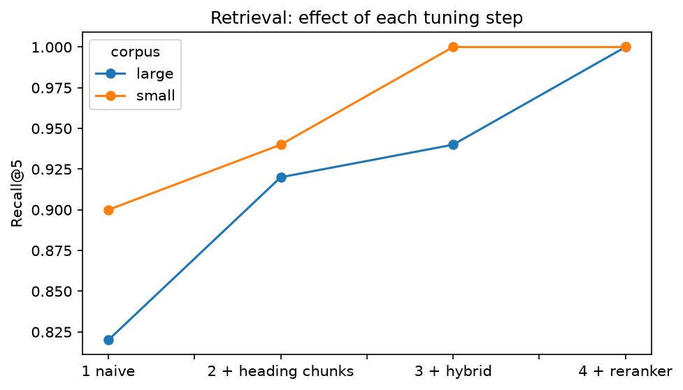
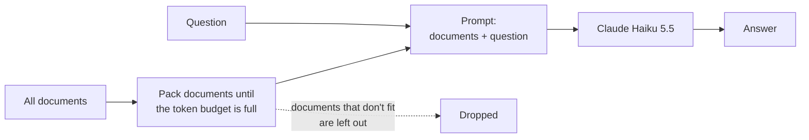
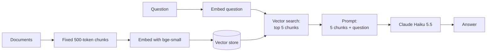
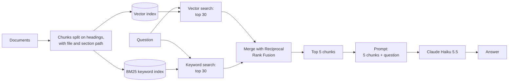
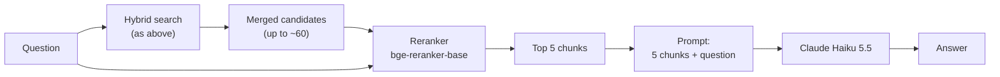

# Is RAG dead? Long context vs. RAG, measured

Context windows now hold hundreds of thousands of tokens, and a popular claim is that companies no longer need RAG: just put every document in the prompt. I tested that claim on 60 hand-verified questions over the Pydantic and FastAPI documentation.

## The finding

**When the documents fit in the context window, long context was the most accurate approach (100% vs 95% for the best RAG), but it cost about 137× more per question ($0.062 vs $0.00045). When they didn't fit, long context fell to 21% accuracy, while tuned RAG held at 91–92%.**

RAG isn't dead. _Naive_ RAG is the weak version (78–83%); hybrid search with better chunking closes most of the gap.



## Results

| Corpus              | Approach                | Accuracy | Right document seen\* | Tokens sent per question | Cost per question | Typical latency (p50) |
| ------------------- | ----------------------- | -------- | --------------------- | ------------------------ | ----------------- | --------------------- |
| Small (fits)        | Long context            | **1.00** | 100%                  | 122,812                  | $0.062            | 3.3 s                 |
| Small (fits)        | Naive RAG               | 0.83     | 90%                   | 3,665                    | $0.0005           | 2.2 s                 |
| Small (fits)        | Tuned hybrid            | 0.95     | 100%                  | 3,258                    | $0.0005           | 1.9 s                 |
| Small (fits)        | Tuned full (+ reranker) | 0.93     | 100%                  | 3,319                    | $0.0005           | 32.1 s                |
| Large (doesn't fit) | Long context            | 0.21     | 10%                   | 176,915                  | $0.089            | 3.8 s                 |
| Large (doesn't fit) | Naive RAG               | 0.78     | 82%                   | 3,697                    | $0.0005           | 2.4 s                 |
| Large (doesn't fit) | Tuned hybrid            | 0.91     | 94%                   | 3,074                    | $0.0005           | 2.1 s                 |
| Large (doesn't fit) | Tuned full (+ reranker) | **0.92** | 100%                  | 3,182                    | $0.0005           | 31.2 s                |

\*For RAG: the correct file was among the 5 retrieved chunks (recall@5). For long context: the correct file fit inside the token budget.

Accuracy is the average grade on 50 answerable questions (correct = 1, partial = 0.5, wrong = 0). Every approach correctly answered "not found" on all 10 unanswerable questions.

## What I learned

1. **Long context works until the data doesn't fit.** On the small corpus it answered every question correctly. On the large corpus, the right document made it into the prompt for only 10% of questions. The model usually said "not found" instead of inventing an answer, which is honest but still useless to the user.
2. **On a small corpus, the trade-off is accuracy vs cost.** Long context was 5 points more accurate than the best RAG, but it sent about 37× more tokens per question. Its prompts were also just over the model's 100k-token price tier, so each token cost 5× more. Together that made it 137× more expensive.
3. **Better retrieval mattered most on the large corpus.** Going from naive RAG to hybrid search with heading-aware chunks raised recall@5 from 82% to 94% and accuracy from 78% to 91%.
4. **The reranker wasn't worth it on a CPU.** It raised recall@5 to 100%, but accuracy only moved by 1 point on the large corpus (and dropped 2 on the small one, within noise). Meanwhile typical latency went from about 2 s to 31 s (p95: 36–42 s). Tuned hybrid is the practical choice here; a GPU or hosted reranker would change that.
5. **The remaining errors happen after retrieval.** All 7 wrong answers from tuned full had the right file retrieved. Five were refusals: the right page was retrieved, but not the section holding the answer, so the model said it couldn't find it (for example q040, about string length constraints, which sits deep in a long reference page). Two were genuine misreadings: for q008 the model reversed how unparametrized generic models serialize. Measuring retrieval at the section level, not just the file level, is the clear next step.





## What I compared

All approaches use the same model (Claude Haiku 5.5) and the same prompt. Only the way the context is gathered changes.

### Long context

Whole documents are packed into the prompt until the token budget is full. There's no search step.



### Naive RAG

The tutorial-style pipeline: fixed chunks, embeddings, top 5 by similarity.



### Tuned hybrid

Chunks follow the document's headings, and two kinds of search are merged.



### Tuned full

The same as tuned hybrid, plus a reranker that reads the question and each candidate together before picking the final 5.



The reranker is what made this approach the most accurate on the large corpus, and also the slowest (about 27 s per question on a laptop CPU).

**Data:** the small corpus is part of the Pydantic docs (about 123k tokens). The large corpus adds the FastAPI, SQLModel and Typer docs, so it no longer fits the budget. Because the small corpus is inside the large one, the same questions work for both.

**Questions:** 60, all hand-checked: 30 single-fact, 10 exact-term, 10 multi-hop and 10 unanswerable. I confirmed each unanswerable question against the full corpus.

**Grading:** an LLM judge (Claude Sonnet 5.5) compared each answer with my gold answer. On 20 random answers, it agreed with my own grading 90% of the time (18 of 20).

## Limitations

- 60 questions, so differences of a few points (one or two questions) aren't meaningful.
- One model, one domain (Python library docs) and an LLM judge.
- Latency was measured on a laptop CPU.
- `recall@5` checks the right file, not the right section of it.
- 10 judge replies were malformed JSON. I fixed the parser to recover the grade and re-graded them.

## Run it yourself

```bash
pip install -r requirements.txt
# add your API key and model settings to .env (see src/llm.py)
python -m src.download
python -m src.ingest
python -m src.eval.run_eval all
python -m src.analyze
```

## Future work

Prompt caching for long context, agentic retrieval (letting the model decide when to search), and a larger question set.

## Data

The documentation belongs to the [Pydantic](https://github.com/pydantic/pydantic), [FastAPI](https://github.com/fastapi/fastapi), [SQLModel](https://github.com/fastapi/sqlmodel) and [Typer](https://github.com/fastapi/typer) projects. It's downloaded by `src/download.py` and not included in this repository.

**[Watch the demo](https://www.linkedin.com/feed/update/urn:li:ugcPost:7521305922648944640/)**
